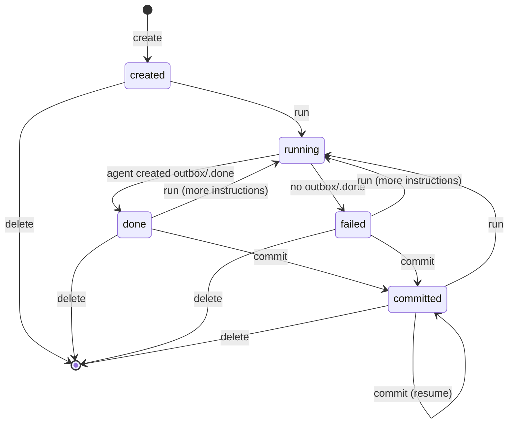

# Design

This document explains how rehearse works and why it is built the way it is. It describes the design, not a particular implementation. For commands and file formats, see [reference.md](reference.md). For step-by-step usage, see [guide.md](guide.md).

## Background

You want an AI agent to organize many large files: move them from a source directory `A` into an existing library `B`.

- The files are too large to copy casually.
- A wrong move or deletion is expensive to recover from, often only from a backup.
- The agent works unattended and may stop early when it gets stuck.
- Afterwards, a human reviews the result and decides whether to accept it, ask for more work, or throw it away.

## Approaches that fall short

**Let the agent run `mv` directly.** This needs no preparation and is as flexible as the shell. But nothing can be undone: a wrong move or deletion takes effect immediately, before anyone has reviewed it.

**Let the agent run `mv` on a filesystem with snapshots.** On a filesystem such as Btrfs, a snapshot taken before the session makes the agent's changes reversible. But it works only on specific filesystems, and `A` and `B` must be covered by the same snapshot. These constraints are too strict for a general tool.

**Let the agent write a script, and run it after review.** Nothing happens until a human approves, so mistakes can be caught in advance. But a script is hard to read. It shows the steps, not the result, and checking hundreds of lines for the one wrong path is tedious and error-prone.

**Build a custom tool from scratch.** In theory, a dedicated program can do anything: record the agent's moves through an API, keep the plan in a database, enforce rules, and present the plan in a review UI. But every one of those capabilities is new code to design, secure, and maintain. The more the tool can do, the more it costs to build.

## Core idea: use the filesystem

rehearse wants the flexibility of plain `mv`, the review-before-change of a script, and the rich behavior of a custom tool, without building that tool. The answer is that every part of the problem already has a solution in the filesystem and standard tools. rehearse combines them instead of building new ones:

| Need | Existing mechanism |
|---|---|
| A way for the agent to act | Ordinary file commands. Agents are already good at `ls`, `find`, `mkdir`, and `mv`. |
| A plan that looks like the result | A tree of symlinks that mirrors `B` (see [Staging with symlinks](#staging-with-symlinks)) |
| Review | Git, which can diff a tree of symlinks (see [Review with git](#review-with-git)) |
| Applying the plan | The `rename(2)` system call, which moves a file atomically without copying it (see [Commit with rename](#commit-with-rename)) |
| Rules the agent cannot break | Read-only mounts, file ownership, and the sticky bit (see [Security considerations](#security-considerations)) |
| Isolation from the host | A container that sees only the directories it needs (see [Security considerations](#security-considerations)) |

This is why rehearse is small. The safety comes from operating system features that already exist and are well understood, not from new code.

### Staging with symlinks

The agent never touches the real files. It only moves symlinks.

rehearse prepares a work directory with two trees of symlinks:

- `inbox/` mirrors `A`. Each entry is a symlink to a file in `A`. This is the pool of files the agent has not placed yet.
- `outbox/` mirrors `B`. It starts with a symlink for every existing file in `B`.

The agent moves symlinks from `inbox/` to the right place in `outbox/`, creating directories as needed. The resulting `outbox/` tree **is** the plan. When the human approves it, rehearse *commits* the plan: it follows each symlink and renames the real file from `A` to the matching place in `B`.

Why symlinks:

- **Provenance is built in.** A symlink's target says where the file came from, so `ls -l` shows it directly.
- **`A` and `B` stay untouched during the session.** Other programs never see a half-finished state.
- **The plan describes itself.** There is no separate manifest that could get out of sync with the files. Whether a file is still waiting or already placed is shown by where its symlink is.

### Review with git

When a session is created, rehearse snapshots the work directory into a git repository. The repository lives in the session directory, outside the agent's view (see [Session](#session)). Because a symlink is stored in git as its target string, git shows the agent's work in a useful way:

- `git status` lists moved symlinks and new notes.
- A symlink that was only moved has identical content, so git detects it as a rename.
- `git diff` shows the change in provenance.

Any git tool can be used for the review. rehearse never reads the repository after creating it, so the reviewer may commit, branch, or edit freely. The reviewer can also edit the plan directly, because the agent's placements are owned by the host user by default.

### Commit with rename

The commit walks `outbox/` and handles each entry:

| Entry | Action |
|---|---|
| Regular file | Skip. It stays in the session. |
| Symlink to a directory | Skip. Only files are moved. |
| Symlink into `refs/b/` | Skip. The file is already in `B`. |
| Symlink into `refs/a/` | Move the real file from `A` to the same relative path in `B`. |
| Any other symlink, including relative ones | Stop. The plan is invalid. |

Before moving a file, rehearse resolves the source path and stops if it is not inside `A`. This catches targets that start with `refs/a/` but escape with `..` or through symlinks.

`A` and `B` must be on the same filesystem (checked when the session is created), so each move is a single atomic `rename(2)`: a file is either moved or not. To make an interrupted commit resumable, each move is decided by the current state of the source and the destination:

| Source exists | Destination exists | Meaning | Action |
|---|---|---|---|
| Yes | No | Not moved yet | Move it |
| No | Yes | Already moved | Skip |
| Yes | Yes | Conflict | Stop |
| No | No | Unexpected | Stop |

Each move, each already-moved file, and each reason to stop is appended to a commit log in the session directory. Commits to the same `B` are serialized with a lock, so two sessions cannot interleave their moves.

After the commit, the session still records the whole plan: each symlink's target says where the file came from, and its location says where it went. The symlinks are now dangling, but they cost only a few bytes each, so keeping old sessions is cheap.

## Session

A session is one directory. It holds everything about one run of the workflow:

| Part | Visible to the agent | Purpose |
|---|---|---|
| Work directory | Yes, read-write (with restrictions below) | `refs/a`, `refs/b`, `inbox/`, `outbox/`, and the agent instructions |
| Agent home | Yes, read-write | The agent's home directory: credentials, settings, conversation history |
| Harness state | No | Session metadata, the review snapshot, the commit log, the run lock |

The work directory contains:

- `refs/a` and `refs/b`: symlinks to the real `A` and `B`. Every symlink in `inbox/` and `outbox/` points into one of them.
- `inbox/` and `outbox/`: the two mirrors described above.
- `AGENTS.md`: the agent's standing instructions, found by the agent's own instruction discovery.

### Lifecycle

- **Create**: rehearse checks the inputs, builds the work directory and agent home, and takes a review snapshot.
- **Run**: rehearse starts the agent in a container and waits for it to exit. A run can be repeated with an extra message, and the agent resumes its previous conversation.
- **Commit**: rehearse moves the real files according to the plan.
- **Delete**: rehearse removes the session directory. Real files are not affected.

The human reviews the plan after a run and before the commit. Review happens outside rehearse, with any tool (see [Review with git](#review-with-git)).

`done` means the agent itself decided the work was finished and created `outbox/.done`. `failed` means it did not: the agent gave up, timed out, or crashed. rehearse treats both the same way. The difference only helps the reviewer.

## Security considerations

rehearse does not trust the agent. It may make mistakes, misunderstand the task, or behave in unexpected ways. The following properties hold no matter what the agent does inside the container.

| Property | Mechanism | Condition |
|---|---|---|
| The real files in `A` and `B` do not change before the commit. | The container mounts `A` and `B` read-only. Only the work directory and agent home are writable. | None |
| The agent can add entries to the `B` mirror, but cannot move or remove the existing ones. | `outbox/` and all its subdirectories have the sticky bit set. The initial entries are owned by a separate *guard* user. With the sticky bit, only the owner of an entry can rename or remove it. | The agent user and the guard user differ (validated when the session is created). |
| The agent cannot rearrange the work directory itself (`refs/`, `inbox/`, `outbox/`, `AGENTS.md`). | These are owned by the guard user and group, and are not writable by others. | The agent and guard users have different groups (validated when the session is created). |
| The agent cannot see or change the harness state. | Only the work directory and agent home are mounted into the container. | None |
| The commit moves only files from `A`, only to places inside `B`, and never overwrites. | See [Commit with rename](#commit-with-rename). | None |

### What is not a boundary

Some measures only guide the agent. They make mistakes less likely, but safety does not depend on them.

- **Removed tools.** The agent images do not include `rm`, `cp`, `ln`, `chmod`, `chown`, `dd`, or `truncate`. However, the images contain language runtimes that can do the same things. The properties above come from mounts, ownership, and the checks made during the commit, not from the missing tools.
- **The instructions.** `AGENTS.md` tells the agent the rules. An agent can ignore them.

### What is not protected

- **Network access.** The agent can reach the network, for example to look up metadata. It can therefore send file names or file contents elsewhere.
- **Changes from outside rehearse.** Other programs can still change `A` and `B` during a session. The commit detects the resulting conflicts and stops, but it does not prevent them.
- **The quality of the plan.** rehearse keeps the files safe. Whether the plan is good is the reviewer's decision.

### Failure model

Before the commit, the worst possible outcome of an agent run is a messy set of symlinks and notes in the work directory. Deleting the session discards it.

During the commit, the worst outcome is that some files are moved and the rest are not. Committing again continues from there.

## Design decisions

**Same paths inside and outside the container.** A symlink target is an absolute path string. If the work directory, `A`, or `B` were mounted at different paths inside the container, the symlinks would break on one side. rehearse mounts each of them at its host path.

**Absolute symlink targets only.** A relative target would change meaning when the agent moves the symlink to another directory. All mirror symlinks are created with absolute targets, and the commit rejects any other kind.

**Separate agent and guard users.** The *agent user* runs the agent. The *guard user* owns the structure the agent must not change. They must differ, because the owner of an entry can always move it. By default, the agent user is the host user. This lets the human edit the agent's placements directly, while only the initial structure belongs to the guard user.

**The agent owns the symlinks it moves.** Entries in `inbox/` are owned by the agent user. A rename keeps the owner, so a symlink the agent has moved stays movable, and the agent can redo its placements as often as it likes. Only the initial `B` mirror is protected.

**`outbox/.done` signals success only.** An agent can fail in many ways (timeout, crash, giving up), and none of them is a reliable signal. Success is a single explicit action, so it is the one that gets a marker.

**The commit skips regular files.** Only symlinks in `outbox/` are part of the plan. Any regular file the agent creates there never reaches `B` and stays in the session as part of the record. So instructions and skills can have the agent write files for any purpose, such as notes on its choices or intermediate results, with no naming rules from rehearse.

**`running` is derived from a lock, not stored.** While the agent runs, the runner holds a lock on the session. Any command that sees the lock held treats the session as running. When the process exits for any reason, the operating system releases the lock, so a crash never leaves a session stuck in `running`.

**The harness does not know the agent or the container runtime.** rehearse starts a *runner* script with a fixed set of environment variables and only observes its exit code. The runner builds the container command. The image's entrypoint starts the agent CLI and decides whether to begin a new conversation or resume one. Supporting another agent CLI or container runtime means writing a new runner or image, not changing rehearse. This also allows tests to use a fake runner without real agents or credentials.

**Agent-specific setup lives in the agent home.** Each session's agent home is a copy of a template directory (a *skeleton*). Credentials, CLI settings, installed plugins, and an optional startup script live there, in each agent's native format. rehearse does not pass host environment variables into the container. The standing instructions are installed as `AGENTS.md` in the work directory, and each agent finds them through its own discovery.

**Preconditions for a session.** `A` and `B` must be on the same filesystem, so that a move is an atomic rename instead of a copy. They must not contain symlinks, so that every mirror entry stands for exactly one real file and the commit moves files, not links.
